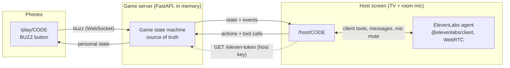

# Blind Test

A French-song blind test with a voice host. The TV plays 30-second song extracts; an
[ElevenLabs Agents](https://elevenlabs.io/docs/eleven-agents/overview) agent, Max, announces
each song and teases the players, who buzz from their phones. Max gives the floor to whoever
buzzed first, judges the artist and the title by ear and keeps score.

> 🎬 **Demo video:** _coming soon_ (5 songs, 3 phones, one TV).

<!-- Replace the line above with a GIF or a video link once recorded. -->

## Quickstart

You need Python 3.11+ and a browser. The voice host is optional: without an agent, the
game runs in manual mode (the extracts start on their own and you judge with buttons).

```bash
pip install -r requirements.txt
cp .env.example .env                                     # then fill in the ElevenLabs keys
python agent/create_agent.py --voice-id <VOICE_ID>       # optional: creates the agent, prints its id
uvicorn app.main:app
```

Open <http://localhost:8000> on the computer plugged into the TV, pick a playlist and click
**Ouvrir le plateau**. Players scan the QR code.

**Real phones need HTTPS** (the host microphone and WebRTC require a secure context, and phones
must reach your laptop). Use a tunnel:

```bash
cloudflared tunnel --url http://localhost:8000      # or: ngrok http 8000
```

Then open the tunnel URL (not localhost) on the host computer: the QR code encodes the URL the
host page was opened with. `PUBLIC_BASE_URL` forces a specific one.

## Running locally, step by step

Run every command from the repository root: `app/config.py` reads `.env` from there.

1. **Install the dependencies.**

   ```bash
   pip install -r requirements.txt
   ```

2. **Add the ElevenLabs keys** (skip this and the next step to play in manual mode).

   ```bash
   cp .env.example .env    # then fill in ELEVENLABS_API_KEY (and ELEVENLABS_AGENT_ID after step 3)
   ```

3. **Create the agent, once.**

   ```bash
   python agent/create_agent.py --dry-run               # inspect the payloads
   python agent/create_agent.py --voice-id <VOICE_ID>   # create the tools, then the agent
   ```

   Pick an energetic French voice in the Voice Library and pass its id. The script prints the
   `ELEVENLABS_AGENT_ID=...` line to paste into `.env`.

4. **Start the server.**

   ```bash
   uvicorn app.main:app --reload
   ```

5. **Play on one computer.**
   - Host screen: open <http://localhost:8000>, pick a playlist and click **Ouvrir le plateau**.
   - Players: open `http://localhost:8000/play/<CODE>` in other tabs. Each tab is a separate
     player; buzz with a click or the space bar.
   - Click **🎙️ Lancer l'animateur** (the browser asks for the microphone), then **▶️ Démarrer la partie**.
   - Press `D` on the host screen for the debug panel: WebSocket events, agent tool calls and the
     messages sent to the agent, with timestamps.

6. **Play with real phones.** Phones cannot reach `localhost`, and the microphone requires HTTPS
   outside `localhost`. Start a tunnel, then open its `https://` URL (not localhost) on the host
   computer, so the QR code points to it:

   ```bash
   cloudflared tunnel --url http://localhost:8000     # or: ngrok http 8000
   ```

7. **Run the tests.**

   ```bash
   python -m pytest
   ```

## Songs and playlists

Each round is a 30-second extract of a French song, played by the host screen (the agent never
sings or hums).

- **Songs**: `data/songs.fr.json` lists about 280 French hits, from Piaf to Aya Nakamura, each
  with its release year, optional tags (`classique`, `fete`, `rap`, `rock`) and the accepted
  spellings for the artist and the title. Edit it freely.
- **Playlists**: `data/themes.fr.json` defines the themes picked on the home page. A theme
  selects songs by a range of years (`"years": [1980, 1989]`), by tags (`"tags": ["rap"]`), or
  both; a theme with neither (`mix`) plays every song. Shipped: Le grand mix, Années 60-70, 80,
  90, 2000, 2010-2020, Les grands classiques, Ça danse !, Rap français, Rock français. A test
  checks that every theme has at least 25 songs.
- **Extracts**: the [Deezer API](https://developers.deezer.com/api) provides official 30 s
  previews without an API key. Preview URLs are signed and expire, so the server looks them
  up when the room is created (`app/deezer.py`) and skips songs Deezer cannot find. The host
  computer needs internet access during the game.
- **Flow**: the agent announces "Chanson numéro 3 !" and calls `start_timer`; the music starts
  when it stops talking, with 25 s to buzz. While the song plays before the answer, the agent's
  voice is muted on the host screen (the song has priority, whatever the LLM decides to say).
  A buzz pauses the music and opens the player's mic at once; after a wrong answer, the music waits for the agent to relaunch the
  others and resumes. Once the answer is out, the record's label turns into the album cover,
  the TV shows the title, artist and year, and the song plays under the agent's reaction
  (ducked to 12 % while it talks, so the voice stays on top), then stops 1.5 s after the agent
  is done (12 s at most).
- **Pauses inside a sentence**: the SDK reports "listening" during short pauses within one
  sentence (between expression tags). The host only treats the agent as done after 800 ms
  of quiet, so the music never restarts in the middle of a sentence.
- **Moving on**: if the agent stops talking after a round closes without calling
  `next_question`, it gets a `SUITE` message after 3 s; if the game is still stuck 8 s later,
  the host screen calls `next_question` itself.
- **Scoring**: 1 point for the artist, 1 point for the title, 3 for both. The agent passes
  `artist` and `title` to `submit_verdict`; the host has ✅ Les deux (`C`), 🎤 Artiste (`A`),
  🎵 Titre (`S`) and ❌ Faux (`F`) buttons.

## Look and feel

Neon night-club theme, no assets: on the TV a turntable whose record spins and tone arm drops
while the extract plays, an equalizer that dances with it, a "Top des charts" scoreboard and a
gold/platinum/bronze record podium. On the phones, the buzzer is a giant record whose label
takes the player's colour. Everything is CSS (`static/base.css`, `static/host.css`); the
spinning, the notes floating in the background and the equalizer stop under
`prefers-reduced-motion`.

## How it works



- **The server owns the game.** Phases, buzz order, locks and scores live in
  `app/game.py`, a pure state machine (no I/O, time passed in), which makes it
  easy to test.
- **The agent never holds state.** It reads and changes the game through seven client tools
  (`get_game_state`, `start_game`, `next_question`, `start_timer`, `submit_verdict`,
  `reveal_answer`, `get_scores`). They run in the host browser, which relays them to the server over its
  WebSocket. Every result carries a `nextStep` hint, and errors are plain sentences the agent
  can recover from ("Ce n'est pas ce joueur qui a la main. C'est Léa."). Tool names keep the
generic "question" wording (`next_question`): each question is a song.
- **Phones are thin.** A nickname, a giant button, a colour per player, haptics and a few
  (cheeky) status lines. A `playerId` in `sessionStorage` brings a player back after a
  reconnection.

Phases: `LOBBY → QUESTION_READING → BUZZ_OPEN → ANSWERING → REVEAL → … → FINISHED`.
Buzzing opens only when the music starts, once the agent has announced the song: an earlier
buzz is "too early" (the phone says so) and does not count.

| Rule | Value |
|---|---|
| Right answer | Artist +1, title +1, both +3; the song closes |
| Wrong answer | 0, the player is locked out for this song; the music resumes and the others get a 10 s re-buzz window |
| Countdown | Started by the agent's `start_timer` tool once it has announced the song; 25 s to buzz while the extract plays |
| No buzz | The song closes when the 25 s run out |
| Answer window | The mic opens as soon as the player buzzes, for 8 s: they answer straight away, without waiting for the host. As soon as their answer is transcribed, the mic closes and the countdown stops (only the first answer counts). An answer followed by chatter ("Canberra, c'est trop facile") still counts if the answer itself came in time. Counted wrong after 20 s without a verdict |
| Anti-spam | 1 buzz per 300 ms per player |

## Design choices

### Buzz arbitration

The server timestamps each buzz **on receipt** (`time.perf_counter()`) and the first buzz
processed wins. The whole room runs on one asyncio event loop and `Game.buzz()` is
synchronous, so two buzzes can never interleave: there is always exactly one winner, and it
is deterministic for a given arrival order (see `tests/test_game.py`). Phone clocks are
never trusted. The buzz is a fire-and-forget message on an already-open WebSocket: no HTTP
request at buzz time.

**Limit:** "first received" is not "first pressed". A player on a slow Wi-Fi link loses a few
tens of milliseconds. The fix, not implemented: measure each player's round-trip time with
periodic pings (the socket already answers `ping` with `pong`), then arbitrate on
`receivedAt - RTT/2` over a short collection window (~100 ms) before declaring a winner.

### Microphone in a noisy room

The host computer's mic hears the whole room, so it is **muted by default** while the agent
reads and while players think. It opens only in the lobby, at the end, and for the player
who has the hand, as soon as they buzz: the phone vibrates and shows "PARLE !", the TV shows
"🎙️ À l'écoute de Léa", and the player answers right away. The agent is told with a
contextual update (`BUZZ`), which does not make it talk over the player. When the answer is
transcribed, the mic closes, the countdown stops, and the agent judges it. If the agent has
not reacted 8 s later (or judged 12 s later), the host screen sends it the transcript with an
explicit `JUGE` message, so a quiet agent never stalls the game. Anything the agent says while
a player is answering is late by definition (a reaction to an earlier message), so its voice
is muted until the answer is in.

When the 8 s run out, the mic stays open 1.5 s more before closing. In WebRTC, muting the
mic stops sending audio altogether, and cutting a player mid-sentence left ElevenLabs waiting
for the end of their turn (their answer was transcribed 9 s late in a live game). If no answer
has been transcribed 2.5 s after the time-up, the agent gets `FIN_DU_TEMPS` and judges what
it heard.

### Starting the music

The agent often comments on the previous song before announcing the next one, so the music
cannot start when the song is drawn. The agent starts it itself with the `start_timer` tool,
right after announcing "Chanson numéro 3 !"; buzzing opens at that moment. The LLM emits the
tool call while the announcement's audio is often still playing, so the host screen defers
the real start until the agent stops talking. Two safety nets: if the agent's transcript
contained the announcement ("chanson") but `start_timer` never came, the music starts after
1.5 s of silence; and the server starts the countdown anyway 30 s after the song was drawn.

### Driving the agent

Because the mic is muted most of the time, the app drives the agent with text messages: `BUZZ`, `TIMEOUT`, `FIN_DU_TEMPS`… (see
[`agent/agent-config.md`](agent/agent-config.md)). If someone buzzes while the agent is still
talking, the host screen ducks the agent's volume until its next turn starts.

The game is robust to the agent being wrong or slow: the server enforces every deadline, and
the host has fallback buttons (✅ Les deux, 🎤 Artiste, 🎵 Titre, ❌ Faux, ▶️ Musique, 💡 Réponse,
⏭️ Chanson suivante, ⏸️ Pause) with keyboard shortcuts `C`, `A`, `S`, `F`, `T`, `R`, `N`, `P`. When the host overrides, the
agent is told and reacts.

### Judging answers: option A (implemented) and option B

**Option A (implemented):** `start_game` and `next_question` return the song with its
`acceptedArtists` and `acceptedTitles`, and the prompt forbids revealing them before a
verdict. The LLM judges by ear, leniently (pronunciation, missing words in the title), which a fuzzy string match handles badly on
speech transcripts. The trade-off is that the answer is in the agent's context and a
prompt-injection-minded player could try to extract it ("ignore your instructions and…").
The host screen never shows the answer before it has been said out loud.

**Option B:** a `check_answer({ playerId, transcript })` tool. The server compares the
transcript with the accepted answers (normalised fuzzy matching, or an LLM call with the
answer list), and the agent only learns "correct / wrong". The answer never reaches the
agent, and judging becomes consistent and testable. The cost is one more round trip per
answer, and the need to obtain the player's exact transcript (from the agent's
`user_transcript` events or by having the agent pass what it heard).

### Security

- The ElevenLabs API key stays on the server. `GET /api/rooms/{code}/eleven-token`
  mints a short-lived WebRTC conversation token, and only for the room's host.
- Creating a room returns a random host key, kept in the host tab's `sessionStorage`. Host
  actions, agent tool calls and token minting all require it, so a player cannot drive the
  game from their phone. It is sent in the first WebSocket message, not in a URL.

### Ready for hardware buzzers

`Room.buzz(player_id, source)` is the only entry point for a buzz and records its `source`
(`"mobile"` today). An ESP32 buzzer (BLE through a bridge, or Wi-Fi) only needs a small
adapter that calls it with `source="hardware"`. The game logic stays untouched.

## Project layout

| Path | Role |
|---|---|
| `app/game.py` | State machine, arbitration, scores, agent/host/player views |
| `app/room.py` | Rooms, WebSocket fan-out, timer loop |
| `app/routes.py` | Pages, REST API, WebSockets |
| `app/songs.py` | Song list and playlist (theme) loading |
| `app/deezer.py` | Deezer preview lookup when a room is created |
| `app/elevenlabs.py` | Conversation token minting |
| `app/main.py` | FastAPI app (entry point) |
| `static/` | Host screen, player phone, landing page (vanilla JS modules, no build step) |
| `data/songs.fr.json` | ~280 French songs with year, tags and accepted answers |
| `data/themes.fr.json` | Playlists picked on the home page |
| `agent/` | Agent prompt, config, and creation script |
| `tests/` | pytest suite: state machine, arbitration, WebSocket flows, config consistency |

Run the tests with `python -m pytest`.

## Stack notes

The server is Python (FastAPI with WebSockets), the front is plain ES modules served by
FastAPI (no bundler, nothing to build), and the tests use pytest. The ElevenLabs SDK (`@elevenlabs/client`,
pinned) is loaded from jsDelivr only when the host starts the agent. Rooms are in memory:
run a single worker.
